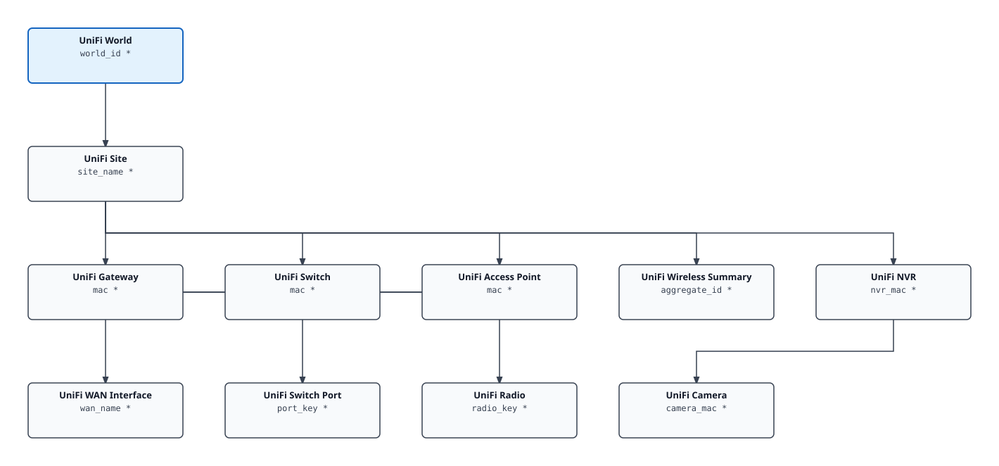

# VCF Content Factory UniFi Controller Documentation

> Generated index. The SVG diagram and per-kind table are regenerated on every
> build; prose sections (overview, installing) are hand-curated.

## Contents

| Section | Description |
|---------|-------------|
| [Overview](overview.md) | What's in the pack, resource kinds, cross-adapter notes |
| [Installing & Configuring](installing.md) | Prerequisites, configuration fields, step-by-step guide |
| [Inventory Tree](inventory-tree.md) | Traversal spec, per-kind table with identifying keys |
| [Metrics Reference](../REFERENCE.md) | Full metrics and properties reference (generated) |

## Inventory Tree

## Quick Reference

- **Adapter kind:** `unifi_controller`
- **Version:** 0.0.0.19
- **Traversal spec:** UniFi Controller Infrastructure
- **Resource kinds:** 11

## Adapter-Specific Documentation

<!-- Merged from docs/_index_extra.md; edit that file, not this section. -->

### Upgrading to build 18

The first cycle after upgrading to build 18 renames every existing switch
port, WAN interface, radio and Wireless Summary to `<label> (<parent>)`
(for example `Port 3 (<switch>)`). History is kept, but saved searches,
custom groups, views filtered by name and notification rules keyed on the
old names need updating. A device renamed on the controller since it was
first discovered takes its current name too (devel: "udm" became
"Bentwood"), so check name-keyed device filters as well. See [README.md, Upgrading to build 18](../README.md#upgrading-to-build-18).

Build 18 also marks objects the controller no longer lists as Not
Existing after 12 consecutive complete cycles, and VCF Operations deletes
them after its Deleted Objects retention (issue #20). The first upgrade
counts every leftover from older builds at once: `<mac>_0` switch ports, a
camera removed from Protect, a gateway no longer listed, all marked about
an hour after the upgrade and then deleted with their history. This cannot
be undone. Removal follows what the controller lists, so narrowing the
account's site access removes those sites and their devices too. Only
named empty answers are guarded: an empty site list, no device on any
site, an empty camera list under a listed NVR, and an empty port table,
radio table or missing `wan1` on a listed device count nothing, so the
last site, the last device, the last camera and those children are
removed by hand. The last device of a type is removed when other devices
are still listed (remove the only switch and it goes, with its ports). See [REFERENCE.md, Removed objects](../REFERENCE.md#removed-objects).

### Alerts

The pak ships eight alerts with their symptoms and recommendations (build
16): gateway, switch, access point and camera offline, uplink port down,
camera not recording, PoE budget nearly exhausted and WAN degraded. What
each fires on, its object and severity: [REFERENCE.md, Alerts](../REFERENCE.md#alerts).
